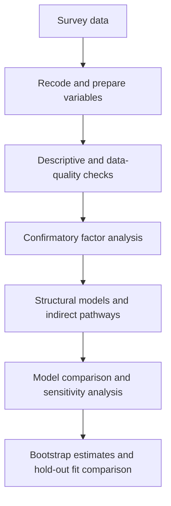

# Latent-Variable Modelling of Religiosity and Attitudes

An R analysis demonstrating confirmatory factor analysis (CFA), structural equation modelling (SEM), mediation, model comparison, bootstrap-based estimation, and a hold-out comparison of model fit.

## Research focus

The analysis examines relationships among latent constructs representing religiosity, attitudes, meaning, and confidence in institutions. It also explores how religiosity, education, and happiness relate to attitudes toward Muslims in the selected survey dataset.

## Analysis workflow



## Methods

- Recode selected categorical variables and missing-value codes.
- Prepare scale scores, reverse-coded items, and analysis variables.
- Inspect descriptive statistics, missingness, distributions, correlations, and multicollinearity.
- Fit a confirmatory factor analysis model for latent constructs.
- Estimate structural models and indirect pathways involving education and happiness.
- Compare model fit, conduct sensitivity analyses, and obtain bootstrap parameter estimates.
- Fit the same prespecified model separately in training and hold-out subsets for a descriptive comparison of fit.

## Implementation

- **Language:** R
- **Main script:** `religiosity_attitudes_sem.R)
- **Core modelling package:** `lavaan`

```r
install.packages(c(
  "haven", "dplyr", "scales", "psych", "car",
  "corrplot", "lavaan", "semPlot"
))
```

## Input data

The script expects the SPSS file `ZA7570_v2-1-0.sav` in the working directory. The dataset is not included; obtain it from its authorised source and comply with its terms of use.

## Interpretation and limitations

The train/test section is a hold-out comparison of model fit, not a predictive-accuracy benchmark. Model specification, missing-data handling, outlier rules, sample splitting, and fit diagnostics should be reviewed in the context of the research question.

The source survey data are required to reproduce numerical results.
